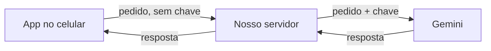

# IA e chaves de API

> [!danger] A regra
> **Nenhuma chave de API pode entrar no aplicativo. Nunca.**
> Nem do Gemini, nem de nenhum outro serviço.

## Por que isso não é exagero

O aplicativo que você instala vai **inteiro** para o seu celular. Todo o código,
todos os textos, todas as configurações. É assim que um app funciona — não tem
outro jeito.

Isso significa que **qualquer pessoa que instale o app consegue abrir e ler o
que tem dentro**. Não é preciso ser hacker: existem ferramentas gratuitas que
fazem isso em minutos.

Então uma chave colocada no app não está escondida. Está publicada.

> [!warning] Não adianta tentar esconder
> As três ideias que todo mundo tem, e por que nenhuma funciona:
>
> | Ideia | Por que falha |
> |---|---|
> | "Coloco numa variável de ambiente" | `EXPO_PUBLIC_*` é literalmente embutido no pacote. O prefixo significa "isto é público" |
> | "Embaralho a chave no código" | O app precisa desembaralhar para usar. Quem lê o código lê o desembaralhador junto |
> | "Escondo num arquivo separado" | Todos os arquivos vão junto no mesmo pacote |

## O que acontece na prática se vazar

Quem extrai a chave passa a usar a **sua** cota do Gemini. Gera imagem, texto,
o que quiser — e **a fatura chega para você**. Já aconteceu com muita gente, e
o prejuízo costuma aparecer só no fim do mês.

## Como fica, então

O app **nunca** fala com o Google. Ele fala com o nosso servidor, e o servidor
— que roda numa máquina que só nós acessamos — é quem tem a chave.

Três coisas que só ficam possíveis desse jeito:

1. **A chave fica num lugar só.** Trocar a chave não exige atualizar o app na loja.
2. **Dá para limitar o uso.** "Cada usuária pode fazer 20 pedidos por dia" só é possível no servidor.
3. **Dá para trocar de fornecedor.** Se o Gemini ficar caro, muda o servidor e nenhum app precisa ser atualizado.

## Onde isso está no código

| Arquivo | Papel |
|---|---|
| `src/features/ia/cliente-ia.ts` | Fala com a **nossa** API. Nunca com o Google |
| `src/lib/flags.ts` → `IA_ATIVA` | Desligado — depende de um servidor que ainda não existe |
| `src/lib/__tests__/sem-chave-exposta.test.ts` | **A trava automática** |

### A trava automática

Recomendação em documento não segura ninguém às 2 da manhã tentando fazer a IA
funcionar. Um teste vermelho segura, porque o CI não deixa passar.

O teste verifica cinco coisas a cada execução:

- nenhuma chave em formato conhecido (Google, OpenAI, GitHub, AWS, Slack) no código;
- nenhuma variável `EXPO_PUBLIC_*` com cara de segredo;
- nenhum `.env` de verdade rastreado pelo git;
- o `.gitignore` bloqueando `.env`;
- nenhuma chamada direta a domínio de provedor de IA.

> [!success] A trava foi testada contra ela mesma
> Em 26/08/2026 uma chave falsa (formato válido, nunca funcionou) foi plantada
> de propósito no código. **Os dois testes ficaram vermelhos na hora.** Depois
> de remover, voltaram ao verde.
>
> Trava que nunca disparou não é trava — é decoração.

## E a privacidade?

O **perfil de estilo continua fora disto**. Ele é calculado no aparelho e não
entra em nenhuma chamada de IA. Ver [[features/08-algoritmo-de-estilo/o-que-e|Algoritmo de estilo]].

O que passaria por IA seria a **foto** que a usuária escolhesse enviar, uma de
cada vez. E foto de pessoa é dado sensível — então antes da primeira chamada
existir de verdade, três coisas precisam estar prontas:

- [ ] Consentimento separado para foto ([#36](https://github.com/Lopesloro/App/issues/36))
- [ ] Remoção de EXIF (localização) antes do envio
- [ ] Registro de quem acessou ([#40](https://github.com/Lopesloro/App/issues/40))

Ver [[06-seguranca]].

## Auditoria de 26/08/2026

| Verificação | Resultado |
|---|---|
| Segredos no código rastreado | ✅ nenhum |
| Segredos no histórico (18 commits) | ✅ nenhum |
| Segredos no pacote web exportado | ✅ nenhum |
| `.env` rastreado | ✅ nenhum (só o `.env.example`) |
| `.gitignore` cobrindo `.env` | ✅ sim |
| Chamada direta a provedor de IA | ✅ nenhuma |

Índice: [[00-INDEX]] · Segurança: [[06-seguranca]] · Checklist: [[CHECKLIST]]
